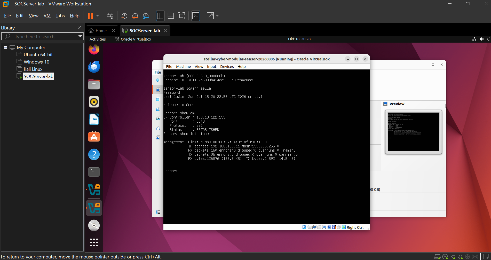
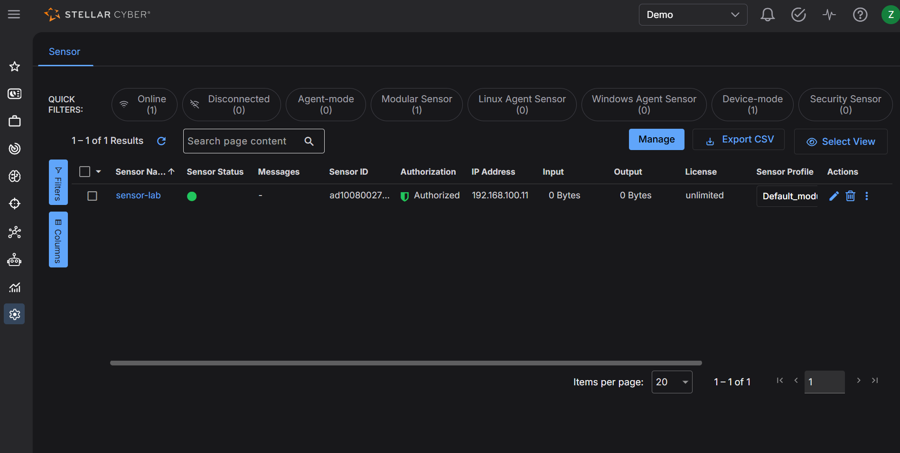
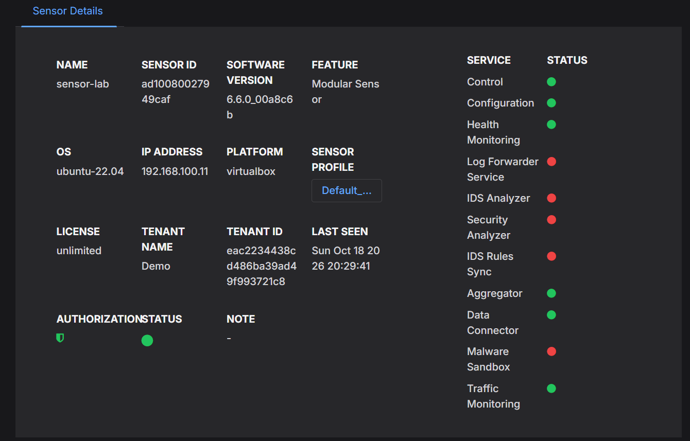

# Modular Sensor Lab

My notes from setting up a Stellar Cyber Modular Sensor on my own laptop. My team lead wanted me to practice the deployment first, before I do one on a client's PC, so I built it at home. It took longer than I thought, mostly because of the nested VM stuff. I'm writing down what I did and what broke so I don't forget it later.

> [!NOTE]
> This is a lab, not a real deployment. I kept the sizes small on purpose.

## Contents

- [Layout](#layout)
- [IP addresses](#ip-addresses)
- [Setup](#setup)
- [Screenshots](#screenshots)
- [Problems](#problems)
- [Next steps](#next-steps)

---

## Layout

Everything runs on my Windows laptop, stacked like this:

```text
Windows laptop
  └── VMware Workstation
        └── Ubuntu 22.04 Desktop VM
              └── VirtualBox
                    └── Modular Sensor VM
```

I copied this from how my team lead has his set up (Ubuntu Desktop, VirtualBox, and the sensor inside it). I actually started on CentOS Stream 10, but the docs I found only list Ubuntu as a supported host, so I deleted it and started over with Ubuntu.

---

## IP addresses

Everything is on VMware's NAT network (VMnet8). I used static IPs outside the DHCP range so nothing clashes.

| What | Value |
|---|---|
| Network | `192.168.100.0/24` |
| Gateway and DNS | `192.168.100.2` |
| DHCP range | `192.168.100.128` to `192.168.100.254` |
| Ubuntu VM | `192.168.100.10` (static) |
| Sensor VM | `192.168.100.11` (static) |

---

## Setup

### 1. Ubuntu VM (in VMware)

| Setting | Value |
|---|---|
| VM name | `SOCServer-lab` |
| OS | Ubuntu 22.04.5 Desktop |
| vCPUs | 8 (4 would probably be enough) |
| RAM | 8 GB |
| Disk | 120 GB |
| Network | NAT (VMnet8) |
| Processor option | **Virtualize Intel VT-x/EPT** ticked |

> [!IMPORTANT]
> The VT-x/EPT box is the one that matters. Without it VirtualBox can't run anything inside the Ubuntu VM.

What I did after installing:

1. Set the static IP in **Settings > Network** (IPv4, Manual): `192.168.100.10`, gateway and DNS `192.168.100.2`.
2. Left the third-party software box unticked in the installer. A VM doesn't need those drivers.
3. Updated the system and installed the VMware tools:

   ```bash
   sudo apt update && sudo apt upgrade -y
   sudo apt install -y open-vm-tools-desktop net-tools
   ```

4. Checked that nested virtualization is passed through. I got `8`, anything above 0 is good:

   ```bash
   egrep -c '(vmx|svm)' /proc/cpuinfo
   ```

5. Installed VirtualBox and added my user to the `vboxusers` group:

   ```bash
   sudo apt install -y virtualbox
   sudo usermod -aG vboxusers $USER
   ```

### 2. Sensor VM (in VirtualBox)

| Setting | Value |
|---|---|
| VM name | `stellar-cyber-modular-sensor-20260806` |
| Image | VMware OVA from the Sensor Installation page, imported into VirtualBox |
| CPU / RAM | about 2 CPUs and 4 GB (lab sizing) |
| Disk | VDI |
| MAC addresses | generated new on import |
| Network adapter 1 | Bridged to `ens33`, Intel PRO/1000 MT Desktop, promiscuous mode **Allow All** |
| Graphics | VMSVGA |
| Software version | 6.6.0 |

Steps:

1. Downloaded the OVA from **Sensor Installation > Download Images** (VMware type) and checked the SHA-1 against the hash file:

   ```bash
   sha1sum aella-modular-ds-*.ova
   ```

2. **File > Import Appliance** in VirtualBox, with the settings from the table above.
3. Started the VM, logged in as `aella`, and ran this at the `Sensor>` prompt:

   ```text
   set hostname sensor-lab
   set interface management ip 192.168.100.11/255.255.255.0
   set interface management gateway 192.168.100.2
   set interface management dns 192.168.100.2
   set tenant_id <tenant id>
   set cm <cm address>
   show cm
   show interface
   ```

4. Authorized the sensor in the platform under a test tenant.

---

## Screenshots

The sensor console. `show cm` says **ESTABLISHED** and `show interface` shows the `192.168.100.11` address.



The sensor list in the Stellar Cyber platform. `sensor-lab` is green and authorized.



The sensor details page. The setup is successful, it's just a bare bones setup.



---

## Problems

### At a glance

| # | Problem | Cause | Fix |
|---|---|---|---|
| 1 | No internet in Ubuntu | VM network adapter was set to Host-only | Switched it to NAT |
| 2 | VirtualBox "Invalid settings detected" | Imported sensor uses the old VBoxVGA graphics controller | Changed it to VMSVGA (it's only a warning) |
| 3 | VirtualBox crashed when starting the sensor | Nested virtualization (VirtualBox inside VMware) | Closed other VMs, plus the fixes listed below |
| 4 | Forgot to set the tenant ID | Skipped `set tenant_id` | Ran it afterwards and checked the platform |

### 1. No internet in Ubuntu

`apt update` kept failing with "Temporary failure resolving", and pinging the gateway gave "Destination Host Unreachable". I thought it might be my laptop's IP changing, but it wasn't. The VM's network adapter was set to Host-only instead of NAT.

I switched it to NAT in the VM settings, the ping to `192.168.100.2` worked straight away, and then I put the static IP back in.

### 2. VirtualBox "Invalid settings detected"

It was a warning about the graphics controller, the imported sensor uses the old VBoxVGA one. It's harmless. I changed it to VMSVGA to get rid of the message.

### 3. VirtualBox crashed when I started the sensor

This was the big one. The message was:

```text
A critical error has occurred while running the virtual machine
```

In `VBox.log` there was a `Guru Meditation` line with `VERR_VMM_SET_JMP_ABORTED_RESUME`. As far as I can tell it's because VirtualBox is running inside a VMware VM, and nested virtualization is just fragile.

What I did:

- Closed all the other VMs on my laptop that I didn't need, so the sensor had more RAM and CPU to work with.
- Edited `SOCServer-lab.vmx` with VMware closed: kept a single `vhv.enable = "TRUE"` (removed the duplicate), added `hypervisor.cpuid.v0 = "FALSE"`, and used 4 vCPUs instead of 8.
- Windows: turned off Memory integrity and Hyper-V / Virtual Machine Platform, ran `bcdedit /set hypervisorlaunchtype off`, then rebooted the laptop.
- VirtualBox sensor VM: **Settings > System > Acceleration**, Paravirtualization set to None and Nested Paging turned off.
- Upgraded VirtualBox from the Ubuntu package to 7.2 from Oracle's repository.

After that the sensor booted in VirtualBox. If none of this works, the fallback is to skip the nested layer and import the OVA straight into VMware Workstation.

<details>
<summary>Commands I used to upgrade VirtualBox to 7.2 (Ubuntu 22.04)</summary>

```bash
sudo apt remove --purge 'virtualbox*'
sudo apt autoremove -y
sudo apt install -y wget gnupg
wget -O- https://www.virtualbox.org/download/oracle_vbox_2016.asc | \
  sudo gpg --dearmor --yes --output /usr/share/keyrings/oracle-virtualbox-2016.gpg
echo "deb [arch=amd64 signed-by=/usr/share/keyrings/oracle-virtualbox-2016.gpg] \
https://download.virtualbox.org/virtualbox/debian jammy contrib" | \
  sudo tee /etc/apt/sources.list.d/virtualbox.list
sudo apt update
sudo apt install -y virtualbox-7.2 build-essential dkms linux-headers-$(uname -r)
sudo reboot
```

The imported VM stays in `~/VirtualBox VMs`, so I didn't need to import the sensor again. Check the version afterwards with `vboxmanage --version`.

</details>

### 4. I forgot to set the tenant ID

I skipped `set tenant_id` the first time. The sensor still connected, so I didn't notice at first. I ran the command afterwards, checked `show cm` was still ESTABLISHED, and looked in the platform to make sure it was under my test tenant.

---

## Next steps

- [ ] Change the default `aella` password
- [ ] Set up a Windows Server VM and practice deploying the Windows agent
- [ ] Try it on a real PC or mini PC, without the nested layer